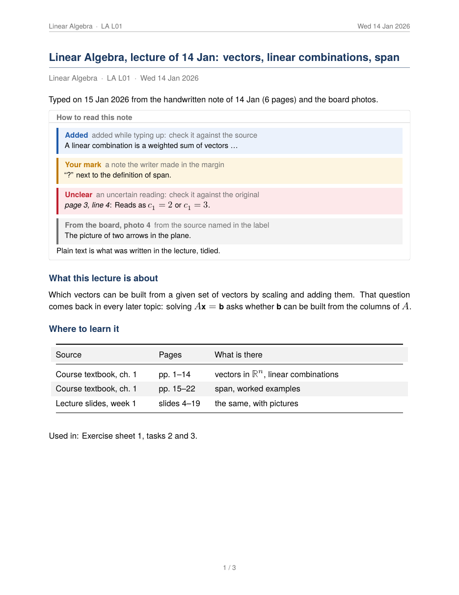

# typeup

[](https://github.com/jpcunhadias/typeup/actions/workflows/ci.yml)
[](LICENSE)

Turn typed-up lecture notes in Markdown into clean, consistent PDFs.

typeup is for notes typed from handwriting, board photos or slides, where
you need to see where each line came from. Its pandoc filter and LaTeX
header add:

- **mark boxes** that say where a line came from: `[Added]` for what the
  typist filled in, `[Your mark]` for the writer's own margin notes,
  `[Unclear]` for readings to check against the original, plus any source
  label you like;
- **numbered content boxes**: definition, theorem, example, exercise,
  proof and others;
- a **"How to read this note" legend** built from real examples;
- **running headers** with course, lecture and date, taken from the file
  name or the front matter;
- **page breaks that keep things together**: a heading or a lead-in line
  ("… is:") never ends a page alone;
- **combined PDFs** of all notes in a date range, with a contents page,
  for exam review;
- a **matplotlib style** for figures in the same fonts and colours.



The [example notes](examples/LinearAlgebra/notes/) and
[their PDFs](examples/LinearAlgebra/notes/pdf/) show every feature.

## Requirements

- [pandoc](https://pandoc.org/installing.html) 3.0 or newer
- XeLaTeX with these packages (all in TeX Live; on Debian/Ubuntu,
  `texlive-xetex texlive-latex-extra texlive-fonts-recommended lmodern`;
  `texlive-science` for the homework template):
  tcolorbox, etoolbox, fancyhdr, lastpage, titlesec, needspace, caption,
  float, unicode-math
- Python 3.11+ and [uv](https://docs.astral.sh/uv/) (or pip)
- For `typeup tex`: latexmk; for `--png` previews: pdftoppm (poppler)

## Install

From a clone:

```bash
git clone https://github.com/jpcunhadias/typeup.git
uv tool install ./typeup   # or: uv tool install git+https://github.com/jpcunhadias/typeup
typeup --version
```

To work on typeup itself, see [CONTRIBUTING.md](CONTRIBUTING.md).

## Use

Write a note. The file name gives the header: date, course code and
lecture number.

```markdown
<!-- LinearAlgebra/notes/2026-01-14 LA L01 Vectors.md -->
# Vectors and spans

::: legend
> **[Added]** A linear combination is a weighted sum …
> **[Unclear: page 3]** Reads as $c_1 = 2$ or $c_1 = 3$.
:::

::: {.definition title="Span"}
The set of all linear combinations of $\mathbf{v}_1, \dots, \mathbf{v}_k$.

> **[Added]** Every vector you can build from them.
:::
```

Render it, or render all notes up to a date into one PDF:

```bash
typeup render "LinearAlgebra/notes/2026-01-14 LA L01 Vectors.md"
typeup combine LinearAlgebra/notes --until 2026-02-01 -o review.pdf
```

`render` writes to `pdf/` beside the note if that folder exists,
otherwise next to the note. The header of the page above reads
"Linear Algebra · LA L01 · Wed 14 Jan 2026".

| Command | What it does |
|---|---|
| `typeup render NOTE.md…` | one PDF per note (`-o` for one note) |
| `typeup combine DIR -o OUT.pdf` | all dated notes in `DIR`, `--from` / `--until` / `--title` |
| `typeup tex FILE.tex` | compile LaTeX with latexmk, aux files in `build/` |
| `typeup template homework\|cheatsheet [DEST]` | copy a LaTeX template |
| `typeup path filter\|header\|mplstyle\|templates` | where the bundled files are |

`render` and `combine` take `--course`, `--label` and `--date` to set the
header, and `--no-file-links` (see [docs/syntax.md](docs/syntax.md#links-to-files)).

## Documentation

- [Note syntax](docs/syntax.md): marks, content boxes, legend, links
- [Header metadata](docs/metadata.md): file names, front matter, flags
- [Look and config](docs/config.md): fonts, margins, legend wording
- [Figures](docs/figures.md): the matplotlib style
- [LaTeX documents](docs/latex.md): `typeup tex` and the templates

## With pandoc alone

The filter and the header work without the Python package:

```bash
pandoc note.md --from=markdown+bracketed_spans --pdf-engine=xelatex \
  --lua-filter=src/typeup/data/marks.lua \
  --include-in-header=src/typeup/data/notes-header.tex \
  -V classoption=table -M course="Linear Algebra" -M date=2026-01-14 \
  -o note.pdf
```

## Contributing

Bug reports, examples of notes that render badly, and pull requests are
welcome. See [CONTRIBUTING.md](CONTRIBUTING.md) and the
[code of conduct](CODE_OF_CONDUCT.md); report security problems as the
[security policy](SECURITY.md) describes.

## Acknowledgements

The page header and footer were inspired by the
[Eisvogel](https://github.com/Wandmalfarbe/pandoc-latex-template) pandoc
template (BSD-3-Clause). typeup uses its own implementation; no Eisvogel
code is included.

## Licence

[MIT](LICENSE)
